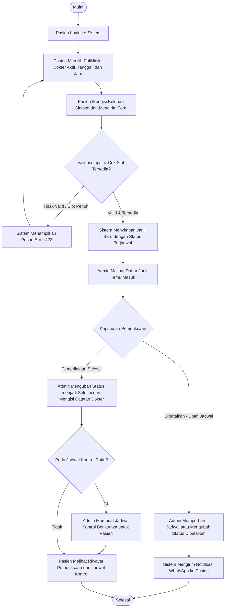
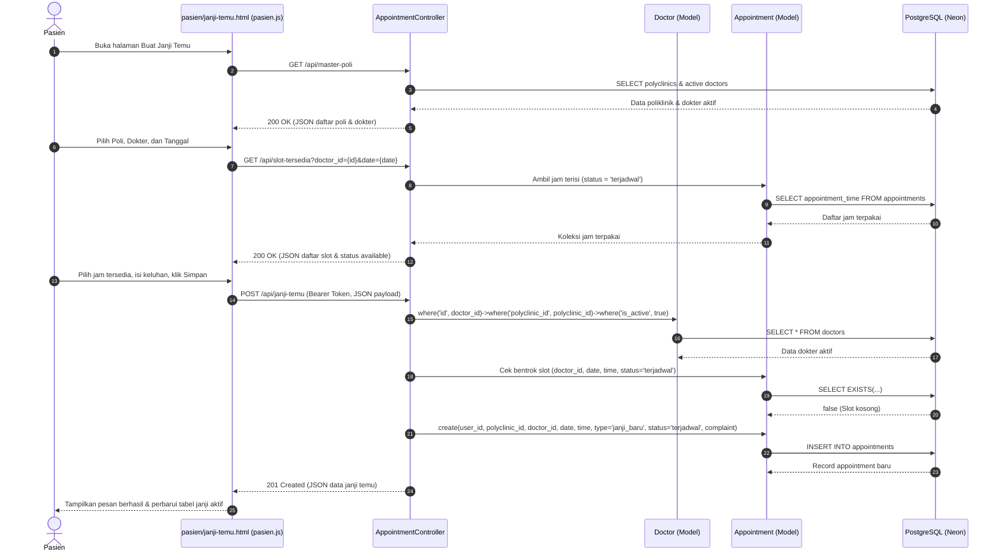
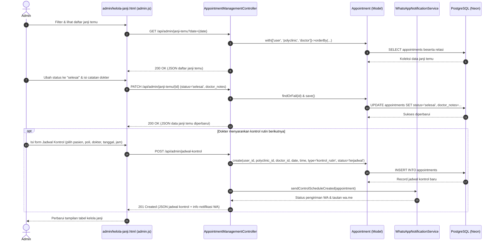

# Dokumentasi Analisis dan Perancangan Sistem: Nuvicare

> [!NOTE]
> **Ruang Lingkup & Sumber Acuan**
> Dokumentasi ini disusun berdasarkan spesifikasi kanonik pada [RANCANGANFINAL.md](RANCANGANFINAL.md) dan keputusan teknis pada [catatan-implementasi.md](catatan-implementasi.md). Seluruh rancangan dibatasi pada fitur inti sistem janji temu rawat jalan tanpa menambahkan fitur di luar ruang lingkup (seperti sistem antrean fisik, resep obat/Fornas, tawar-menawar perubahan jadwal berlapis, atau log audit kompleks).

---

## 1. Analisis Kebutuhan Sistem

### 1.1 Identifikasi Stakeholder

Sistem **Nuvicare** melibatkan dua aktor utama yang berinteraksi langsung dengan aplikasi:

| Stakeholder | Peran di Sistem (`role`) | Tanggung Jawab Utama |
| :--- | :--- | :--- |
| **Pasien (Pengguna)** | `pasien` | 1. Melakukan pendaftaran akun mandiri (termasuk verifikasi OTP WhatsApp) dan autentikasi.<br>2. Memilih poliklinik, dokter aktif, tanggal, dan jam praktik untuk membuat janji temu baru (`janji_baru`).<br>3. Memantau daftar janji temu aktif yang terjadwal.<br>4. Melihat riwayat pemeriksaan yang telah selesai beserta catatan hasil pemeriksaan dokter.<br>5. Memantau jadwal kontrol rutin (`kontrol_rutin`) yang dijadwalkan oleh klinik.<br>6. Mengelola informasi profil pribadi (nama, nomor telepon, tanggal lahir, alamat, kata sandi). |
| **Admin (Staf Klinik)** | `admin` | 1. Mengelola data master poliklinik (`polyclinics`) dan data dokter (`doctors`) beserta status aktif praktiknya (`is_active`).<br>2. Memantau daftar seluruh janji temu dan jadwal kontrol pasien berdasarkan filter tanggal, status, atau dokter.<br>3. Memperbarui status janji temu (`terjadwal`, `selesai`, `dibatalkan`), menyesuaikan jadwal bila diperlukan, dan mencatat hasil pemeriksaan dokter (`doctor_notes`).<br>4. Menjadwalkan kunjungan kontrol rutin berikutnya (`kontrol_rutin`) bagi pasien sesuai anjuran dokter. |

> [!IMPORTANT]
> **Catatan Batasan Aktor:** Dokter tidak memiliki akun login tersendiri di dalam sistem. Pencatatan hasil pemeriksaan (`doctor_notes`) dan pembuatan jadwal kontrol ulang dilakukan oleh **Admin (Staf Klinik)** berdasarkan hasil pemeriksaan dokter.

---

### 1.2 Kebutuhan Fungsional

Kebutuhan fungsional dikelompokkan berdasarkan hak akses setiap stakeholder:

#### A. Fungsi Umum & Autentikasi
1. **Informasi Layanan Publik (`GET /api/public-info` & `GET /api/master-poli`):** Menampilkan daftar poliklinik beserta dokter yang berstatus aktif (`is_active = true`).
2. **Registrasi & Verifikasi Pasien (`POST /api/register`, `/api/auth/register/send-otp`, `/api/auth/register/verify-otp`):** Mendaftarkan akun pasien baru dengan validasi kode OTP WhatsApp.
3. **Login & Logout (`POST /api/login`, `POST /api/auth/google`, `POST /api/logout`):** Mengautentikasi pengguna menggunakan email dan kata sandi atau akun Google, menerbitkan token akses Laravel Sanctum, mengarahkan pengguna sesuai perannya (`pasien` atau `admin`), dan mencabut token saat logout.

#### B. Fungsi Area Pasien (`role = 'pasien'`)
1. **Pengecekan Slot & Pembuatan Janji Temu (`GET /api/slot-tersedia`, `POST /api/janji-temu`):** Memeriksa ketersediaan jam praktik dokter pada tanggal tertentu dan menyimpan janji temu baru (`type = 'janji_baru'`, `status = 'terjadwal'`) beserta keluhan singkat (`complaint`).
2. **Daftar Janji Temu Aktif (`GET /api/janji-temu`):** Menampilkan daftar janji temu milik pasien yang sedang login.
3. **Riwayat Pemeriksaan (`GET /api/riwayat-pemeriksaan`):** Menampilkan daftar kunjungan pasien yang telah berstatus `'selesai'` lengkap dengan tanggal, poliklinik, dokter pemeriksa, dan catatan pemeriksaan (`doctor_notes`).
4. **Jadwal Kontrol (`GET /api/jadwal-kontrol`):** Menampilkan daftar jadwal kunjungan ulang (`type = 'kontrol_rutin'`, `status = 'terjadwal'`) milik pasien.
5. **Manajemen Profil (`GET /api/profil`, `PATCH /api/profil`):** Menampilkan dan memperbarui informasi akun serta data diri pasien (`name`, `phone_number`, `birth_date`, `address`, `password`).

#### C. Fungsi Area Admin (`role = 'admin'`)
1. **Kelola Data Master Poliklinik (`POST /api/admin/poli`):** Menambahkan poliklinik baru ke dalam sistem.
2. **Kelola Data Master Dokter (`POST /api/admin/dokter`, `PATCH /api/admin/dokter/{id}`):** Menambahkan dokter baru yang terhubung ke poliklinik tertentu serta mengubah status aktif praktik dokter (`is_active`).
3. **Pemantauan Janji Temu (`GET /api/admin/janji-temu`):** Melihat seluruh daftar janji temu dan jadwal kontrol pasien dengan dukungan penyaringan berdasarkan tanggal (`date`), status (`status`), tipe (`type`), atau dokter (`doctor_id`).
4. **Pembaruan Status & Catatan Pemeriksaan (`PATCH /api/admin/janji-temu/{id}`):** Mengubah status janji temu menjadi `'selesai'` atau `'dibatalkan'`, memperbarui catatan hasil pemeriksaan (`doctor_notes`), atau menyesuaikan jadwal pemeriksaan disertai pemberitahuan WhatsApp ke pasien.
5. **Penjadwalan Kontrol Rutin (`GET /api/admin/pasien`, `POST /api/admin/jadwal-kontrol`):** Memilih pasien dan membuatkan jadwal pemeriksaan lanjutan (`type = 'kontrol_rutin'`, `status = 'terjadwal'`).

---

### 1.3 Kebutuhan Non-Fungsional

1. **Performa dan Responsivitas**
   - Komunikasi antarmuka dan server menggunakan pertukaran data ringan berformat JSON (`Accept: application/json`) melalui `fetch()` tanpa pemuatan ulang seluruh aset halaman server-side.
   - Antarmuka web responsif menyesuaikan ukuran layar perangkat desktop (`>= 1024px`), tablet (`640px - 1023px`), hingga ponsel (`< 640px`) dengan target sentuh minimal `44x44px`.
   - Pencegahan bentrok jadwal (*double booking*) ditangani langsung di tingkat basis data menggunakan *partial unique index* pada kombinasi `(doctor_id, appointment_date, appointment_time)` untuk status `'terjadwal'`.

2. **Keamanan dan Perlindungan Data**
   - **Autentikasi Berbasis Token:** Menggunakan Laravel Sanctum (`Bearer Token`) untuk setiap endpoint terproteksi.
   - **Isolasi Hak Akses (Role-Based Access Control):** [`RoleMiddleware`](../app/Http/Middleware/RoleMiddleware.php) memvalidasi peran pengguna; akses tanpa token ditolak dengan status `401 Unauthorized`, sedangkan akses silang peran ditolak dengan `403 Forbidden`.
   - **Isolasi Data Pasien:** Seluruh query pada controller pasien mengambil identitas dari token pengguna yang terautentikasi (`$request->user()->id`), bukan dari parameter input pengguna.
   - **Keamanan Kredensial & Koneksi:** Kata sandi dienkripsi dengan algoritma hashing satu arah (`bcrypt`/`argon2`), rahasia konfigurasi disimpan di `.env`, dan koneksi ke PostgreSQL Neon dienkripsi dengan `sslmode=require`.

3. **Teknologi yang Digunakan**
   - **Backend:** PHP 8.2+, Laravel Framework (murni sebagai penyedia JSON API di [`routes/api.php`](../routes/api.php)), Laravel Eloquent ORM, dan Laravel Sanctum.
   - **Basis Data:** PostgreSQL (Neon Serverless Postgres).
   - **Frontend:** HTML5 semantik, CSS3 murni ([`public/css/style.css`](../public/css/style.css)), dan Vanilla JavaScript (`fetch()` API di [`public/js/api.js`](../public/js/api.js)) tanpa ketergantungan framework frontend atau proses kompilasi bundler.
   - **Integrasi Eksternal:** Layanan pengiriman pesan WhatsApp (Fonnte API) untuk OTP dan pemberitahuan perubahan jadwal.

4. **Kemudahan Penggunaan dan Pemeliharaan Sistem**
   - **Pemisahan Tanggung Jawab (Separation of Concerns):** Kode controller dipisahkan secara tegas antara [`app/Http/Controllers/Api/Patient/`](../app/Http/Controllers/Api/Patient/AppointmentController.php) dan [`app/Http/Controllers/Api/Admin/`](../app/Http/Controllers/Api/Admin/AppointmentManagementController.php).
   - **Standar Kualitas Kode & Pengujian:** Format kode dijaga konsisten menggunakan Laravel Pint (`vendor/bin/pint --test`) dan setiap endpoint diuji secara otomatis menggunakan PHPUnit Feature Test (`php artisan test`).
   - **Kejelasan Antarmuka:** Kontras warna memenuhi standar aksesibilitas WCAG AA (minimal `4.5:1` untuk teks), menggunakan Bahasa Indonesia yang lugas, dan menyajikan pesan validasi langsung pada kolom formulir terkait (`422 Unprocessable Entity`).

---

## 2. Perancangan Sistem Berorientasi Objek (OOP)

### 2.1 Activity Diagram

Diagram berikut menggambarkan alur aktivitas bisnis utama di sistem Nuvicare, mulai dari pendaftaran janji temu oleh **Pasien**, pemeriksaan ketersediaan slot oleh **Sistem**, hingga penyelesaian pemeriksaan dan pembuatan jadwal kontrol rutin oleh **Admin**.



**Kode Mermaid (Activity Diagram):**

```text
flowchart TD
    Start([Mulai]) --> Login[Pasien Login ke Sistem]
    Login --> PilihPoli[Pasien Memilih Poliklinik, Dokter Aktif, Tanggal, dan Jam]
    PilihPoli --> InputKeluhan[Pasien Mengisi Keluhan Singkat dan Mengirim Form]
    InputKeluhan --> CekValidasi{Validasi Input & Cek Slot Tersedia?}

    CekValidasi -- Tidak Valid / Slot Penuh --> TampilError[Sistem Menampilkan Pesan Error 422]
    TampilError --> PilihPoli

    CekValidasi -- Valid & Tersedia --> SimpanJanji[Sistem Menyimpan Janji Baru dengan Status Terjadwal]
    SimpanJanji --> TampilJanji[Admin Melihat Daftar Janji Temu Masuk]

    TampilJanji --> TindakanAdmin{Keputusan Pemeriksaan}

    TindakanAdmin -- Dibatalkan / Ubah Jadwal --> UpdateBatal[Admin Memperbarui Jadwal atau Mengubah Status Dibatalkan]
    UpdateBatal --> KirimNotif[Sistem Mengirim Notifikasi WhatsApp ke Pasien]
    KirimNotif --> End([Selesai])

    TindakanAdmin -- Pemeriksaan Selesai --> UpdateSelesai[Admin Mengubah Status menjadi Selesai dan Mengisi Catatan Dokter]
    UpdateSelesai --> CekKontrol{Perlu Jadwal Kontrol Rutin?}

    CekKontrol -- Ya --> BuatKontrol[Admin Membuat Jadwal Kontrol Berikutnya untuk Pasien]
    BuatKontrol --> LihatHasil[Pasien Melihat Riwayat Pemeriksaan dan Jadwal Kontrol]
    CekKontrol -- Tidak --> LihatHasil

    LihatHasil --> End
```

**Penjelasan Activity Diagram:**
1. Proses diawali ketika pasien masuk ke aplikasi, memilih poliklinik, dokter yang aktif, tanggal kunjungan, serta jam praktik.
2. Sistem memvalidasi apakah dokter tersebut aktif di poliklinik yang dipilih dan memastikan slot jam pada tanggal tersebut belum terisi. Bila slot sudah terisi, sistem mengembalikan respons `422` dan meminta pasien memilih jadwal lain.
3. Setelah janji temu tersimpan dengan status `terjadwal`, Admin memantau janji temu tersebut pada hari kunjungan.
4. Setelah pasien selesai diperiksa dokter, Admin mengubah status janji menjadi `selesai` dan memasukkan catatan pemeriksaan (`doctor_notes`). Bila dokter menyarankan kunjungan ulang, Admin langsung menjadwalkan `kontrol_rutin` yang otomatis tampil di halaman Jadwal Kontrol pasien.

---

### 2.2 Sequence Diagram

#### A. Sequence Diagram: Pembuatan Janji Temu oleh Pasien

Menggambarkan urutan interaksi objek saat pasien memeriksa slot dan membuat janji temu baru.



**Kode Mermaid (Sequence Diagram Pasien):**

```text
sequenceDiagram
    autonumber
    actor Pasien
    participant UI as pasien/janji-temu.html (pasien.js)
    participant API as AppointmentController
    participant DocModel as Doctor (Model)
    participant AppModel as Appointment (Model)
    participant DB as PostgreSQL (Neon)

    Pasien->>UI: Buka halaman Buat Janji Temu
    UI->>API: GET /api/master-poli
    API->>DB: SELECT polyclinics & active doctors
    DB-->>API: Data poliklinik & dokter aktif
    API-->>UI: 200 OK (JSON daftar poli & dokter)

    Pasien->>UI: Pilih Poli, Dokter, dan Tanggal
    UI->>API: GET /api/slot-tersedia?doctor_id={id}&date={date}
    API->>AppModel: Ambil jam terisi (status = 'terjadwal')
    AppModel->>DB: SELECT appointment_time FROM appointments
    DB-->>AppModel: Daftar jam terpakai
    AppModel-->>API: Koleksi jam terpakai
    API-->>UI: 200 OK (JSON daftar slot & status available)

    Pasien->>UI: Pilih jam tersedia, isi keluhan, klik Simpan
    UI->>API: POST /api/janji-temu (Bearer Token, JSON payload)
    API->>DocModel: where('id', doctor_id)->where('polyclinic_id', polyclinic_id)->where('is_active', true)
    DocModel->>DB: SELECT * FROM doctors
    DB-->>DocModel: Data dokter aktif
    API->>AppModel: Cek bentrok slot (doctor_id, date, time, status='terjadwal')
    AppModel->>DB: SELECT EXISTS(...)
    DB-->>AppModel: false (Slot kosong)
    API->>AppModel: create(user_id, polyclinic_id, doctor_id, date, time, type='janji_baru', status='terjadwal', complaint)
    AppModel->>DB: INSERT INTO appointments
    DB-->>AppModel: Record appointment baru
    API-->>UI: 201 Created (JSON data janji temu)
    UI-->>Pasien: Tampilkan pesan berhasil & perbarui tabel janji aktif
```

---

#### B. Sequence Diagram: Penyelesaian Pemeriksaan & Pembuatan Jadwal Kontrol oleh Admin

Menggambarkan urutan interaksi objek saat Admin menyelesaikan pemeriksaan pasien dan menjadwalkan kontrol rutin berikutnya.



**Kode Mermaid (Sequence Diagram Admin):**

```text
sequenceDiagram
    autonumber
    actor Admin
    participant UI as admin/kelola-janji.html (admin.js)
    participant Ctrl as AppointmentManagementController
    participant AppModel as Appointment (Model)
    participant WA as WhatsAppNotificationService
    participant DB as PostgreSQL (Neon)

    Admin->>UI: Filter & lihat daftar janji temu
    UI->>Ctrl: GET /api/admin/janji-temu?date={date}
    Ctrl->>AppModel: with(['user', 'polyclinic', 'doctor'])->orderBy(...)
    AppModel->>DB: SELECT appointments beserta relasi
    DB-->>AppModel: Koleksi data janji temu
    Ctrl-->>UI: 200 OK (JSON daftar janji temu)

    Admin->>UI: Ubah status ke "selesai" & isi catatan dokter
    UI->>Ctrl: PATCH /api/admin/janji-temu/{id} (status='selesai', doctor_notes)
    Ctrl->>AppModel: findOrFail(id) & save()
    AppModel->>DB: UPDATE appointments SET status='selesai', doctor_notes=...
    DB-->>AppModel: Sukses diperbarui
    Ctrl-->>UI: 200 OK (JSON data janji temu diperbarui)

    opt Dokter menyarankan kontrol rutin berikutnya
        Admin->>UI: Isi form Jadwal Kontrol (pilih pasien, poli, dokter, tanggal, jam)
        UI->>Ctrl: POST /api/admin/jadwal-kontrol
        Ctrl->>AppModel: create(user_id, polyclinic_id, doctor_id, date, time, type='kontrol_rutin', status='terjadwal')
        AppModel->>DB: INSERT INTO appointments
        DB-->>AppModel: Record jadwal kontrol baru
        Ctrl->>WA: sendControlScheduleCreated(appointment)
        WA-->>Ctrl: Status pengiriman WA & tautan wa.me
        Ctrl-->>UI: 201 Created (JSON jadwal kontrol + info notifikasi WA)
    end
    UI-->>Admin: Perbarui tampilan tabel kelola janji
```

**Penjelasan Sequence Diagram:**
- Interaksi selalu melewati lapisan Controller API setelah token dan peran pengguna diverifikasi oleh middleware.
- Pada alur pasien, validasi dilakukan dua lapis: pengecekan ketersediaan slot via `GET /api/slot-tersedia` dan validasi atomik saat penyimpanan `POST /api/janji-temu`.
- Pada alur admin, pembaruan status pemeriksaan dan pembuatan jadwal kontrol disimpan ke tabel yang sama (`appointments`) dengan pembeda nilai atribut `type` (`janji_baru` vs `kontrol_rutin`) dan `status` (`terjadwal`, `selesai`, `dibatalkan`).

---

### 2.3 Class Diagram

Class diagram berikut merepresentasikan struktur kelas Model Eloquent, Layanan (*Service*), dan Controller utama sesuai implementasi objek pada aplikasi.

```mermaid
classDiagram
    class User {
        +int id
        +string name
        +string email
        +string google_id
        +string password
        +string role
        +string phone_number
        +datetime phone_verified_at
        +date birth_date
        +string address
        +datetime created_at
        +datetime updated_at
        +hasVerifiedPhone() bool
        +appointments() HasMany
        +sendPasswordResetNotification(string token) void
    }

    class Polyclinic {
        +int id
        +string name
        +string description
        +datetime created_at
        +datetime updated_at
        +doctors() HasMany
        +appointments() HasMany
    }

    class Doctor {
        +int id
        +int polyclinic_id
        +string name
        +bool is_active
        +datetime created_at
        +datetime updated_at
        +polyclinic() BelongsTo
        +appointments() HasMany
    }

    class Appointment {
        +string[] TIME_SLOTS
        +int id
        +int user_id
        +int polyclinic_id
        +int doctor_id
        +date appointment_date
        +string appointment_time
        +string type
        +string status
        +string complaint
        +string doctor_notes
        +datetime created_at
        +datetime updated_at
        +user() BelongsTo
        +patient() BelongsTo
        +polyclinic() BelongsTo
        +doctor() BelongsTo
    }

    class WhatsappOtp {
        +int id
        +string phone_number
        +string purpose
        +string code_hash
        +array payload
        +int attempts
        +datetime expires_at
        +datetime created_at
        +datetime updated_at
        +isExpired() bool
    }

    class AuthController {
        +publicInfo() JsonResponse
        +sendRegisterOtp(Request request, WhatsAppNotificationService waService) JsonResponse
        +verifyRegisterOtp(Request request) JsonResponse
        +register(Request request) JsonResponse
        +login(Request request) JsonResponse
        +googleAuth(Request request) JsonResponse
        +logout(Request request) JsonResponse
        +masterPoli() JsonResponse
    }

    class AppointmentController {
        +availableSlots(Request request) JsonResponse
        +index(Request request) JsonResponse
        +store(Request request) JsonResponse
    }

    class HistoryController {
        +index(Request request) JsonResponse
    }

    class ControlScheduleController {
        +index(Request request) JsonResponse
    }

    class ProfileController {
        +show(Request request) JsonResponse
        +update(Request request) JsonResponse
    }

    class AppointmentManagementController {
        +patients() JsonResponse
        +index(Request request) JsonResponse
        +update(Request request, int id, WhatsAppNotificationService waService) JsonResponse
        +storeControlSchedule(Request request, WhatsAppNotificationService waService) JsonResponse
    }

    class PolyclinicController {
        +store(Request request) JsonResponse
    }

    class DoctorController {
        +store(Request request) JsonResponse
        +update(Request request, int id) JsonResponse
    }

    class WhatsAppNotificationService {
        +sendOtpCode(string phoneNumber, string otpCode, int expiryMinutes) array
        +sendAppointmentChangeNotification(Appointment appointment, array changes) array
        +sendControlScheduleCreated(Appointment appointment) array
        +normalizePhone(string phone) string
    }

    User "1" --> "0..*" Appointment : memiliki
    Polyclinic "1" --> "0..*" Doctor : menaungi
    Polyclinic "1" --> "0..*" Appointment : melayani
    Doctor "1" --> "0..*" Appointment : menangani

    AppointmentController ..> Appointment : mengelola
    AppointmentController ..> Doctor : memvalidasi
    HistoryController ..> Appointment : membaca
    ControlScheduleController ..> Appointment : membaca
    ProfileController ..> User : memperbarui
    AppointmentManagementController ..> Appointment : mengelola
    AppointmentManagementController ..> WhatsAppNotificationService : menggunakan
    AuthController ..> User : mengautentikasi
    AuthController ..> WhatsappOtp : memverifikasi
    AuthController ..> WhatsAppNotificationService : menggunakan
    PolyclinicController ..> Polyclinic : membuat
    DoctorController ..> Doctor : mengelola
```



**Kode Mermaid (Class Diagram):**

```text
classDiagram
    class User {
        +int id
        +string name
        +string email
        +string google_id
        +string password
        +string role
        +string phone_number
        +datetime phone_verified_at
        +date birth_date
        +string address
        +datetime created_at
        +datetime updated_at
        +hasVerifiedPhone() bool
        +appointments() HasMany
        +sendPasswordResetNotification(string token) void
    }

    class Polyclinic {
        +int id
        +string name
        +string description
        +datetime created_at
        +datetime updated_at
        +doctors() HasMany
        +appointments() HasMany
    }

    class Doctor {
        +int id
        +int polyclinic_id
        +string name
        +bool is_active
        +datetime created_at
        +datetime updated_at
        +polyclinic() BelongsTo
        +appointments() HasMany
    }

    class Appointment {
        +string[] TIME_SLOTS
        +int id
        +int user_id
        +int polyclinic_id
        +int doctor_id
        +date appointment_date
        +string appointment_time
        +string type
        +string status
        +string complaint
        +string doctor_notes
        +datetime created_at
        +datetime updated_at
        +user() BelongsTo
        +patient() BelongsTo
        +polyclinic() BelongsTo
        +doctor() BelongsTo
    }

    class WhatsappOtp {
        +int id
        +string phone_number
        +string purpose
        +string code_hash
        +array payload
        +int attempts
        +datetime expires_at
        +datetime created_at
        +datetime updated_at
        +isExpired() bool
    }

    class AuthController {
        +publicInfo() JsonResponse
        +sendRegisterOtp(Request request, WhatsAppNotificationService waService) JsonResponse
        +verifyRegisterOtp(Request request) JsonResponse
        +register(Request request) JsonResponse
        +login(Request request) JsonResponse
        +googleAuth(Request request) JsonResponse
        +logout(Request request) JsonResponse
        +masterPoli() JsonResponse
    }

    class AppointmentController {
        +availableSlots(Request request) JsonResponse
        +index(Request request) JsonResponse
        +store(Request request) JsonResponse
    }

    class HistoryController {
        +index(Request request) JsonResponse
    }

    class ControlScheduleController {
        +index(Request request) JsonResponse
    }

    class ProfileController {
        +show(Request request) JsonResponse
        +update(Request request) JsonResponse
    }

    class AppointmentManagementController {
        +patients() JsonResponse
        +index(Request request) JsonResponse
        +update(Request request, int id, WhatsAppNotificationService waService) JsonResponse
        +storeControlSchedule(Request request, WhatsAppNotificationService waService) JsonResponse
    }

    class PolyclinicController {
        +store(Request request) JsonResponse
    }

    class DoctorController {
        +store(Request request) JsonResponse
        +update(Request request, int id) JsonResponse
    }

    class WhatsAppNotificationService {
        +sendOtpCode(string phoneNumber, string otpCode, int expiryMinutes) array
        +sendAppointmentChangeNotification(Appointment appointment, array changes) array
        +sendControlScheduleCreated(Appointment appointment) array
        +normalizePhone(string phone) string
    }

    User "1" --> "0..*" Appointment : memiliki
    Polyclinic "1" --> "0..*" Doctor : menaungi
    Polyclinic "1" --> "0..*" Appointment : melayani
    Doctor "1" --> "0..*" Appointment : menangani

    AppointmentController ..> Appointment : mengelola
    AppointmentController ..> Doctor : memvalidasi
    HistoryController ..> Appointment : membaca
    ControlScheduleController ..> Appointment : membaca
    ProfileController ..> User : memperbarui
    AppointmentManagementController ..> Appointment : mengelola
    AppointmentManagementController ..> WhatsAppNotificationService : menggunakan
    AuthController ..> User : mengautentikasi
    AuthController ..> WhatsappOtp : memverifikasi
    AuthController ..> WhatsAppNotificationService : menggunakan
    PolyclinicController ..> Polyclinic : membuat
    DoctorController ..> Doctor : mengelola
```

**Penjelasan Class Diagram:**
- **Empat Kelas Entitas Inti (`User`, `Polyclinic`, `Doctor`, `Appointment`):** Mengenkapsulasi struktur tabel basis data beserta relasi Eloquent (`HasMany` dan `BelongsTo`). Kelas `Appointment` menjadi pusat transaksi yang menghubungkan `User` (pasien), `Polyclinic`, dan `Doctor`.
- **Kelas Pendukung Autentikasi (`WhatsappOtp`, `WhatsAppNotificationService`):** Menangani logika pengiriman dan validasi OTP WhatsApp serta pemberitahuan perubahan jadwal tanpa membebani kelas Model utama.
- **Pemisahan Kelas Controller:** Controller pasien (`AppointmentController`, `HistoryController`, `ControlScheduleController`, `ProfileController`) terpisah dari controller admin (`AppointmentManagementController`, `PolyclinicController`, `DoctorController`), memastikan setiap kelas memiliki satu tanggung jawab yang jelas (*Single Responsibility*).

---

## 3. Perancangan Basis Data (DBML)

Berikut adalah definisi skema basis data sistem **Nuvicare** dalam format **DBML (Database Markup Language)** yang merepresentasikan 4 tabel inti beserta tabel pendukung verifikasi OTP sesuai skema aktif:

```dbml
Project Nuvicare {
  database_type: 'PostgreSQL'
  Note: 'Skema Basis Data Sistem Janji Temu Kesehatan Nuvicare'
}

Enum user_role {
  pasien
  admin
}

Enum appointment_type {
  janji_baru
  kontrol_rutin
}

Enum appointment_status {
  terjadwal
  selesai
  dibatalkan
}

Table users {
  id bigint [pk, increment, note: 'Primary Key pengguna']
  name varchar(255) [not null, note: 'Nama lengkap pasien atau admin']
  email varchar(255) [not null, unique, note: 'Alamat email untuk login']
  google_id varchar(255) [unique, null, note: 'ID akun Google untuk OAuth login']
  password varchar(255) [not null, note: 'Hash kata sandi']
  role user_role [not null, default: 'pasien', note: 'Peran pengguna: pasien atau admin']
  phone_number varchar(30) [null, note: 'Nomor telepon/WhatsApp aktif']
  phone_verified_at timestamp [null, note: 'Waktu verifikasi OTP nomor WhatsApp']
  birth_date date [null, note: 'Tanggal lahir pasien']
  address text [null, note: 'Alamat domisili pasien']
  remember_token varchar(100) [null]
  created_at timestamp [null]
  updated_at timestamp [null]

  Indexes {
    phone_number [name: 'users_phone_number_index']
  }
}

Table polyclinics {
  id bigint [pk, increment, note: 'Primary Key poliklinik']
  name varchar(255) [not null, unique, note: 'Nama poliklinik (contoh: Poli Umum, Poli Gigi)']
  description text [null, note: 'Deskripsi singkat layanan poliklinik']
  created_at timestamp [null]
  updated_at timestamp [null]
}

Table doctors {
  id bigint [pk, increment, note: 'Primary Key dokter']
  polyclinic_id bigint [not null, ref: > polyclinics.id, note: 'Relasi ke poliklinik tempat dokter bertugas']
  name varchar(255) [not null, note: 'Nama lengkap dokter beserta gelar']
  is_active boolean [not null, default: true, note: 'Status aktif praktik dokter']
  created_at timestamp [null]
  updated_at timestamp [null]
}

Table appointments {
  id bigint [pk, increment, note: 'Primary Key janji temu']
  user_id bigint [not null, ref: > users.id, note: 'Pasien pemilik janji temu']
  polyclinic_id bigint [not null, ref: > polyclinics.id, note: 'Poliklinik tujuan']
  doctor_id bigint [not null, ref: > doctors.id, note: 'Dokter yang menangani']
  appointment_date date [not null, note: 'Tanggal kunjungan pemeriksaan']
  appointment_time varchar(5) [not null, default: '09:00', note: 'Jam praktik kunjungan (format HH:MM, rentang 08:00-16:00)']
  type appointment_type [not null, default: 'janji_baru', note: 'janji_baru dibuat pasien; kontrol_rutin dibuat admin']
  status appointment_status [not null, default: 'terjadwal', note: 'Status siklus pemeriksaan']
  complaint text [null, note: 'Keluhan singkat yang diisi pasien']
  doctor_notes text [null, note: 'Catatan hasil pemeriksaan yang diisi admin']
  created_at timestamp [null]
  updated_at timestamp [null]

  Indexes {
    (user_id, status, type) [name: 'appointments_user_status_type_idx']
    (appointment_date, status) [name: 'appointments_date_status_idx']
    (doctor_id, appointment_date, appointment_time) [unique, name: 'appointments_active_slot_unique', note: 'Partial unique index WHERE status = terjadwal untuk mencegah double booking']
  }
}

Table whatsapp_otps {
  id bigint [pk, increment, note: 'Primary Key catatan OTP WhatsApp']
  phone_number varchar(30) [not null, note: 'Nomor WhatsApp tujuan OTP']
  purpose varchar(30) [not null, default: 'register', note: 'Tujuan OTP: register atau verify_phone']
  code_hash varchar(255) [not null, note: 'Hash dari 6 digit kode OTP']
  payload json [null, note: 'Data pendaftaran sementara sebelum OTP terverifikasi']
  attempts smallint [not null, default: 0, note: 'Jumlah percobaan verifikasi']
  expires_at timestamp [not null, note: 'Batas waktu kedaluwarsa OTP (TTL 5 menit)']
  created_at timestamp [null]
  updated_at timestamp [null]

  Indexes {
    (phone_number, purpose) [name: 'whatsapp_otps_phone_purpose_idx']
  }
}
```

**Penjelasan Rancangan Basis Data:**
1. **Tabel Terpadu `appointments`:** Sesuai prinsip kesederhanaan pada [RANCANGANFINAL.md](RANCANGANFINAL.md), sistem tidak memecah tabel menjadi tabel janji temu, tabel rekam medis, dan tabel jadwal kontrol secara terpisah. Ketiga kebutuhan tersebut ditangani oleh satu tabel `appointments` melalui kombinasi kolom `type` (`janji_baru`, `kontrol_rutin`) dan `status` (`terjadwal`, `selesai`, `dibatalkan`).
2. **Integritas Referensial:**
   - `doctors.polyclinic_id` merujuk ke `polyclinics.id` (`ON DELETE CASCADE`).
   - `appointments.user_id` merujuk ke `users.id` (`ON DELETE CASCADE`).
   - `appointments.polyclinic_id` dan `appointments.doctor_id` masing-masing merujuk ke `polyclinics.id` dan `doctors.id` (`ON DELETE CASCADE`).
3. **Pencegahan Bentrok Jadwal Tanpa Tabel Slot Terpisah:** Indeks unik parsial `appointments_active_slot_unique` pada `(doctor_id, appointment_date, appointment_time)` dengan kondisi `WHERE status = 'terjadwal'` memastikan satu dokter tidak pernah memiliki dua jadwal aktif pada tanggal dan jam yang sama, sekaligus mengizinkan slot tersebut dipesan kembali apabila janji sebelumnya telah berstatus `'dibatalkan'`.
